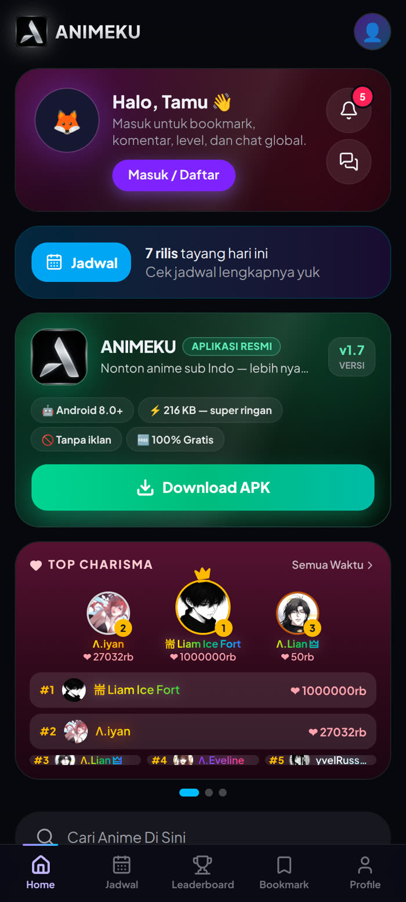
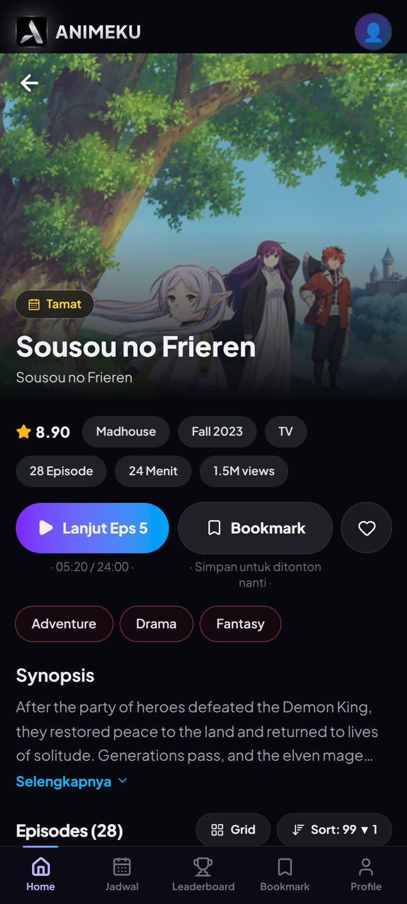
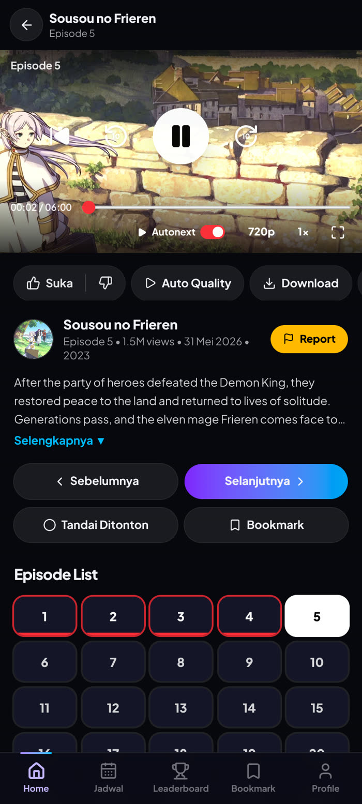
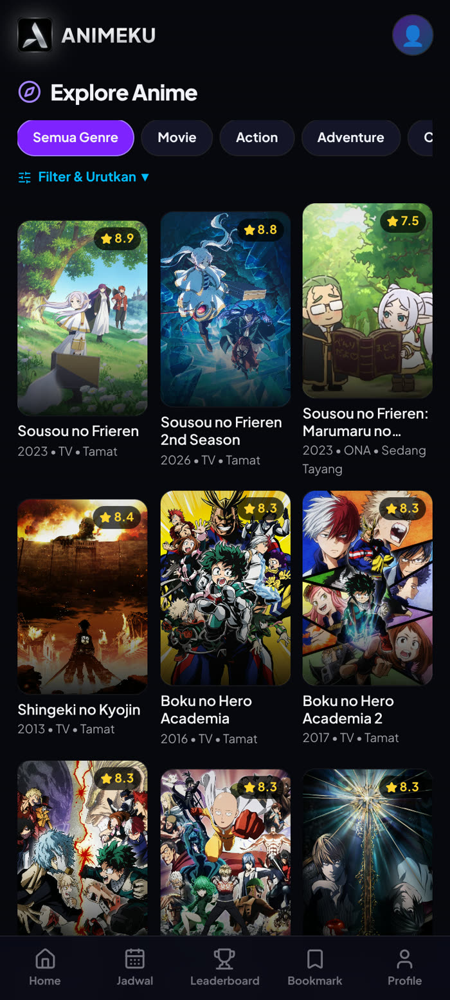
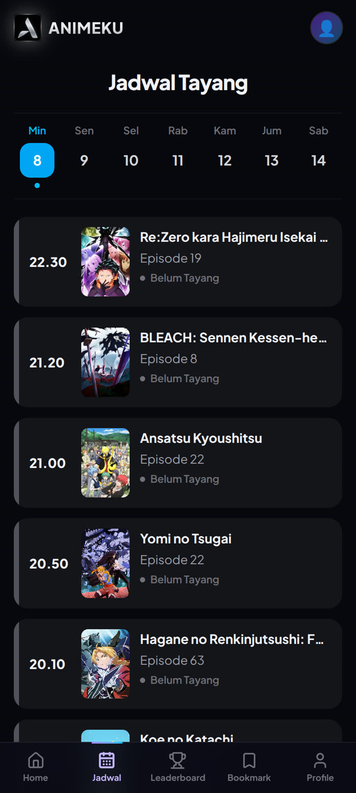
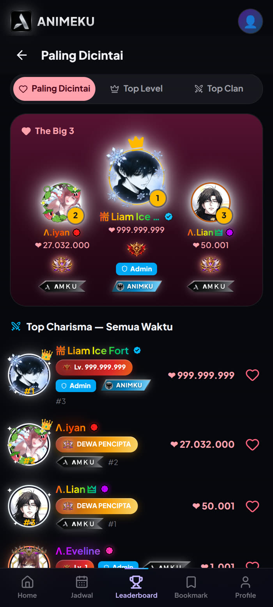
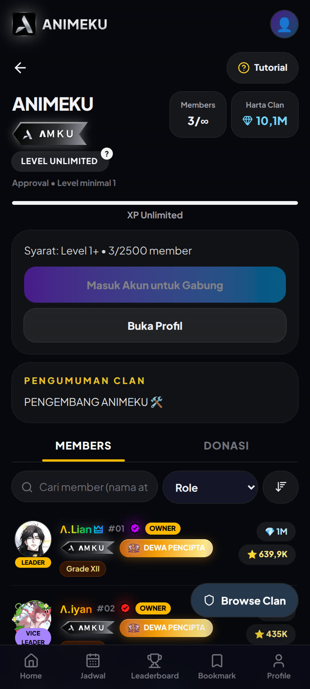
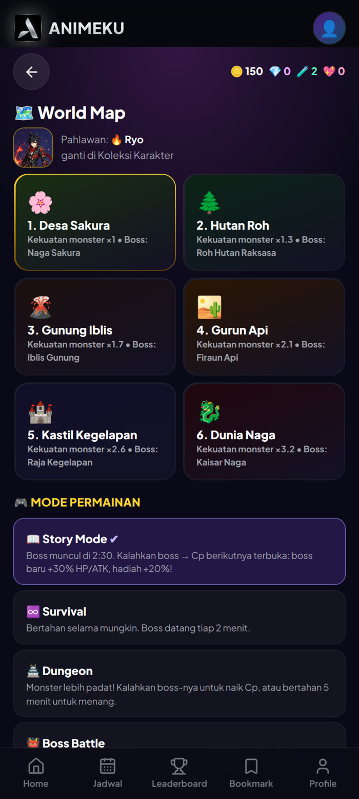

# 🎌 ANIMEKU — Aplikasi Nonton Anime Sub Indo

**ANIMEKU** adalah aplikasi nonton anime subtitle Indonesia gratis — ribuan anime & donghua, update tiap hari, TANPA iklan.

## 📥 Download Aplikasi (Android)

### 👉 [⬇️ DOWNLOAD ANIMEKU.apk — v1.7](https://github.com/iyannsysu/animeku-app/releases/latest/download/ANIMEKU.apk)

Atau buka halaman [Releases](https://github.com/iyannsysu/animeku-app/releases) untuk memilih versi.

**Syarat:** Android 8.0 atau lebih baru • Ukuran hanya ±216 KB

## 📸 Tampilan Aplikasi

<table>
  <tr>
    <td width="50%">
      
       <b>🏠 Beranda</b> — peringkat charisma, jadwal rilis, dan rekomendasi pilihan dalam satu layar.
    </td>
    <td width="50%">
      
       <b>🎬 Detail Anime</b> — info lengkap plus tombol <b>Lanjut Nonton</b>: episode terakhir lanjut dari menit terakhir kamu berhenti.
    </td>
  </tr>
  <tr>
    <td width="50%">
      
       <b>▶️ Player Kustom</b> — ganti kualitas, autonext episode, dan posisi nonton tersimpan otomatis.
    </td>
    <td width="50%">
      
       <b>🔎 Jelajah</b> — ribuan anime dengan filter genre dan urutan sesukamu.
    </td>
  </tr>
  <tr>
    <td width="50%">
      
       <b>🗓️ Jadwal Tayang</b> — jadwal rilis per hari lengkap dengan jam tayang, jangan sampai ketinggalan episode baru.
    </td>
    <td width="50%">
      
       <b>❤️ Top Charisma</b> — podium Paling Dicintai: kumpulkan cinta dari pengguna lain dan rebut posisi teratas.
    </td>
  </tr>
  <tr>
    <td width="50%">
      
       <b>⚔️ Clan</b> — bangun clan bareng teman, kumpulkan harta clan, dan naikkan levelnya.
    </td>
    <td width="50%">
      
       <b>🎮 RPG Animeku</b> — mini game RPG di dalam aplikasi: 6 peta, boss raksasa, dan leaderboard mingguan berhadiah.
    </td>
  </tr>
</table>

## 📲 Cara Install

1. Tekan tombol download di atas, tunggu sampai selesai.
2. Buka file **ANIMEKU.apk** yang terunduh.
3. Jika muncul peringatan, izinkan **"Install dari sumber tidak dikenal"** untuk browser/File Manager kamu.
4. Tekan **Install** — selesai! Buka ANIMEKU dan selamat menonton 🎉

## ✨ Fitur

- 🎬 Ribuan anime & donghua subtitle Indonesia, update setiap hari
- 🚫 Tanpa iklan sama sekali
- 🔎 Pencarian cepat & jadwal rilis harian
- ❤️ Daftar favorit & riwayat tontonan tersimpan
- 👥 Clan, chat, dan profil ala media sosial
- 🎮 Mini game: RPG Animeku & Fruit Farming
- 🔔 Notifikasi episode baru

## 🌐 Versi Web

Tidak mau install? Tonton langsung di browser: **https://animekuui.web.id**

---

© ANIMEKU — Dibuat dengan ❤️ untuk para wibu Indonesia.
